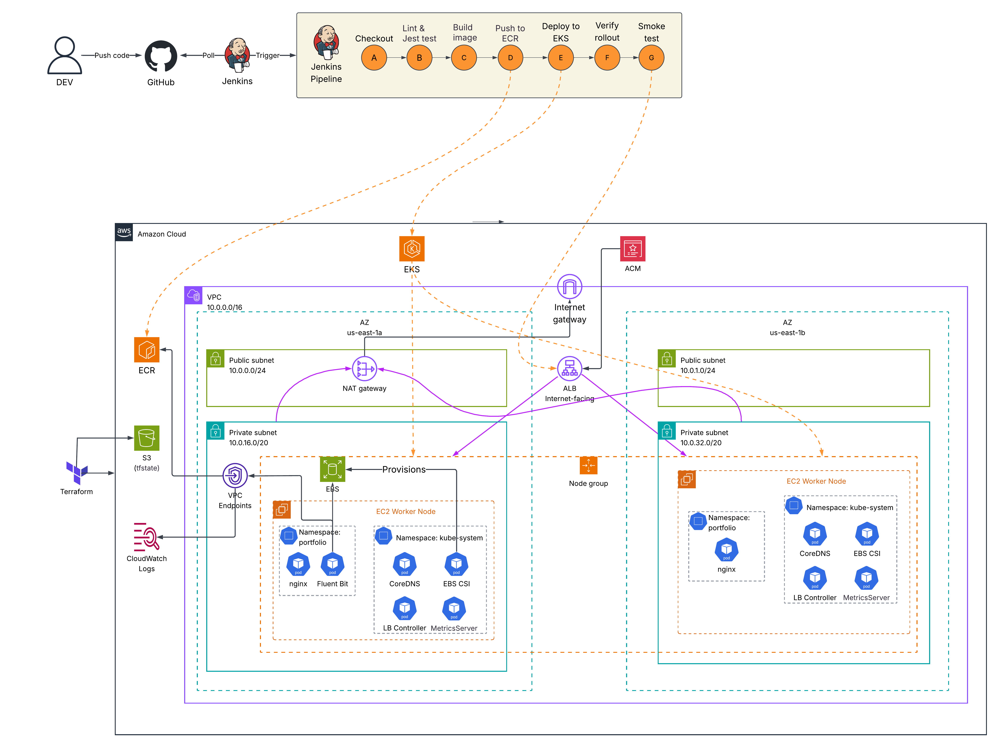
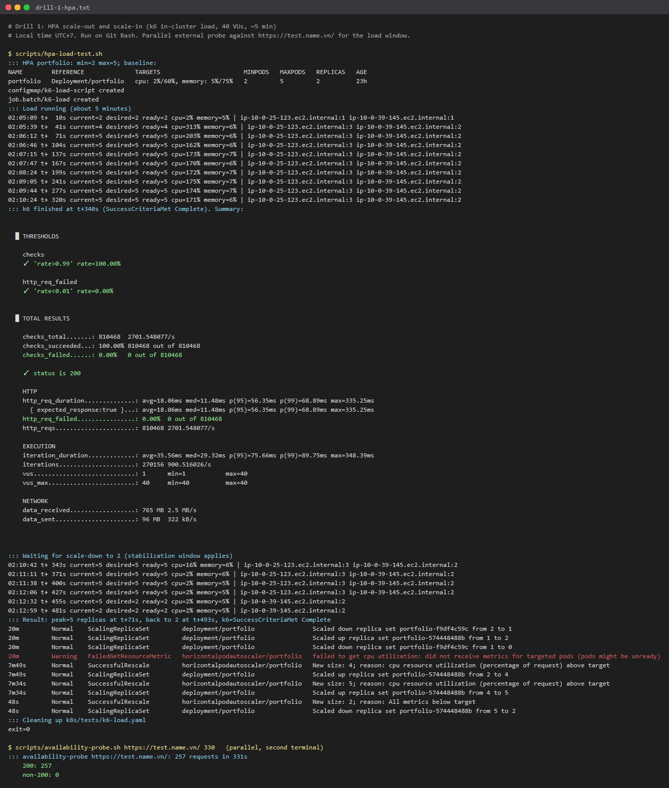
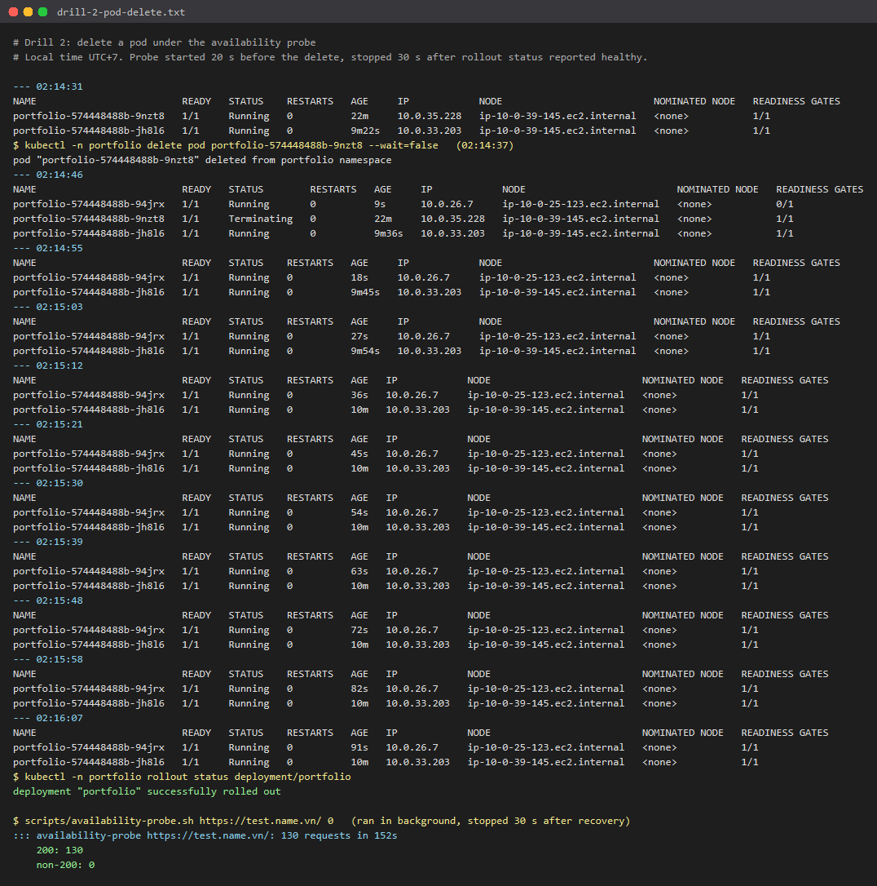
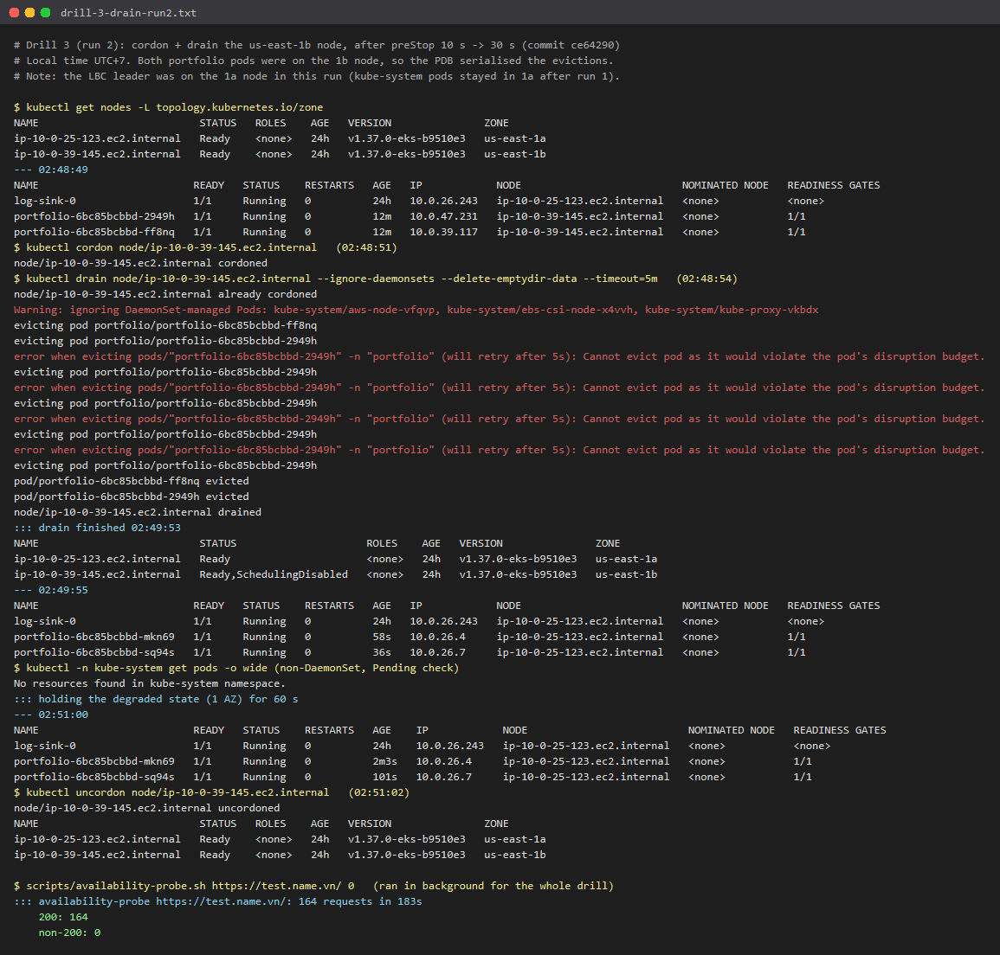
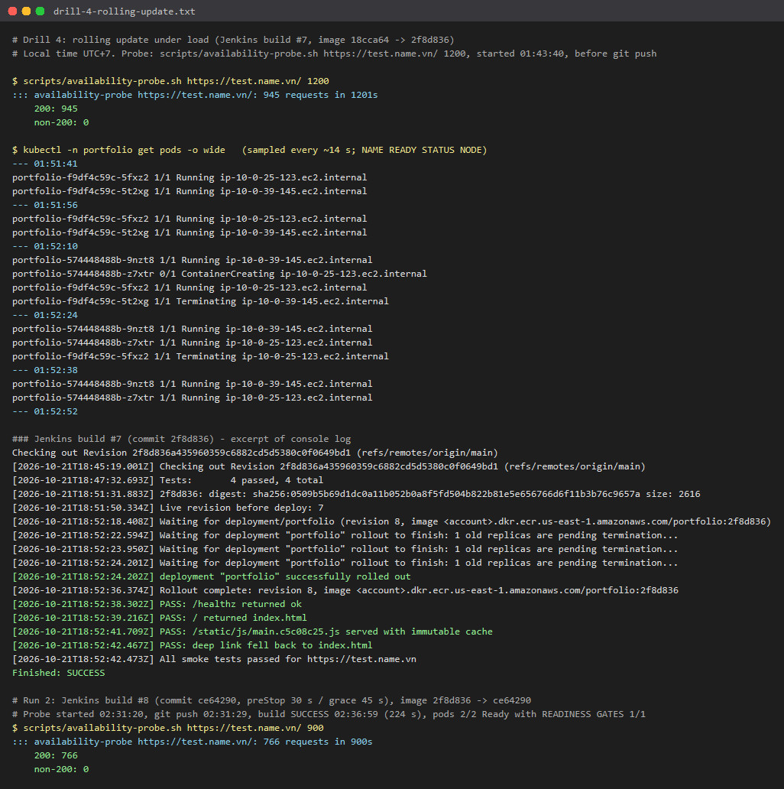

# DevOps Portfolio

         

A static React portfolio taken from "works on GitHub Pages" to a reproducible, production-style deployment on AWS: Terraform-provisioned VPC and EKS, a Jenkins pipeline that tests, builds, pushes to ECR and rolls out to Kubernetes with automatic rollback, an HTTPS ALB in front, and zero-downtime behaviour that is measured with drills rather than assumed.

| | |
|---|---|
| Live URL  | `https://test.name.vn` |
| Region / cluster | `us-east-1`, `eks-portfolio` (EKS 1.37, 2 × t3.medium, 2 AZs) |
| Pipeline | Jenkins (local Docker, JCasC) → ECR → EKS |
| IaC | Terraform, 3 roots (`bootstrap`, `infra`, `platform`), S3 backend with native locking |
| Runbook | [docs/deployment-guide.md](./docs/deployment-guide.md) |
| Running cost | ~$249/month always-on, ~$0.34/hour on demand |

## Table of contents

- [Architecture](#architecture)
- [Problem and goals](#problem-and-goals)
- [Tech stack](#tech-stack)
- [CI/CD pipeline](#cicd-pipeline)
- [Infrastructure as Code](#infrastructure-as-code)
- [Kubernetes workload design](#kubernetes-workload-design)
- [Security](#security)
- [Observability](#observability)
- [Resilience evidence](#resilience-evidence)
- [Cost and FinOps](#cost-and-finops)
- [Deploy and tear down](#deploy-and-tear-down)
- [Repository layout](#repository-layout)
- [Local development](#local-development)

## Architecture



Request path: user → `test.name.vn` (CNAME at an external DNS provider) → internet-facing ALB in the public subnets (TLS terminated with an ACM certificate) → portfolio pods on port 8080 in the private subnets, spread over `us-east-1a` and `us-east-1b`.

Delivery path: developer pushes to GitHub → local Jenkins polls `main` → lint and Jest tests → Docker build → push to ECR with an immutable git-SHA tag → `kubectl apply -k` to EKS → rollout verification (auto-undo on failure) → smoke test against the public URL.

Network:

- VPC `10.0.0.0/16`, public `/24` and private `/20` subnets in two AZs. Worker nodes have no public IPs.
- One NAT Gateway for general egress. S3 gateway endpoint plus interface endpoints for `ecr.api`, `ecr.dkr` and `logs`, so image pulls and log shipping stay on private IPs.
- Security group chain: ALB SG accepts 80/443 from the internet; node SG accepts 8080 only from the ALB SG; endpoint SG accepts 443 only from the node SG.
- EKS API: public endpoint restricted to the admin IP (`admin_cidrs`), private endpoint enabled.

Logging: nginx → syslog UDP 5140 → Fluent Bit `log-sink` StatefulSet (gp3 PVC) → PVC copy plus CloudWatch Logs `/eks/eks-portfolio/portfolio-nginx`.

## Problem and goals

The starting point was a Create React App template wired for GitHub Pages, with a broken test and a `homepage` subpath that renders a blank page at a domain root. The target was a deployment that holds up to interview questions:

1. Everything reproducible from an empty AWS account with Terraform and a written runbook.
2. CI/CD with tests as a gate, immutable artifacts and automatic rollback.
3. No downtime during pod loss, node or AZ loss, scaling and rolling updates, proven with an external probe.
4. Least privilege for humans, CI and pods.
5. Cost that is known up front and can drop to near zero between demos.

## Tech stack

| Layer | Choice |
|---|---|
| App | React 18, TypeScript, Sass, Jest + Testing Library, ESLint (`--max-warnings=0`) |
| Container | Multi-stage Dockerfile: `node:22-alpine` build → `nginxinc/nginx-unprivileged:1.30-alpine` runtime, both pinned by digest, BuildKit npm cache mount, `HEALTHCHECK` on `/healthz` |
| Cloud | AWS: VPC, EKS, EC2 managed node group (AL2023), ECR, ALB, ACM, NAT Gateway, VPC endpoints, KMS, CloudWatch Logs, S3, IAM |
| IaC | Terraform ≥ 1.10, `terraform-aws-modules` (vpc, eks v21, iam), Helm provider for the AWS Load Balancer Controller |
| Kubernetes | Kustomize, AWS Load Balancer Controller 3.6, EBS CSI driver, metrics-server, HPA, PDB |
| CI/CD | Jenkins in Docker, configured as code (JCasC + `plugins.txt`), declarative `Jenkinsfile` |
| Logging | Fluent Bit StatefulSet, CloudWatch Logs |
| Testing | Jest (JUnit + Cobertura reports in Jenkins), `smoke-test.sh`, `availability-probe.sh`, k6 load Job |

## CI/CD pipeline

Defined in [Jenkinsfile](./Jenkinsfile). Jenkins runs locally from [jenkins/](./jenkins) (`docker compose up`), bound to loopback only, and polls `main` every 2 minutes because a local instance can't receive GitHub webhooks.

| # | Stage | What it does |
|---|---|---|
| A | Checkout | Resolves the short git SHA as the image tag, validates `OVERRIDE_IMAGE_TAG`, installs `ingress-config.env` from a Jenkins secret file |
| B | Lint & Test | `npm ci`, `npm run lint`, `npm run test:ci`; publishes JUnit results and Cobertura coverage |
| C | Build Image | `docker build` with OCI labels (`org.opencontainers.image.revision`) |
| D | Push | Assumes `jenkins-deployer`, logs in to ECR and pushes. Skips the push if the tag already exists (tags are IMMUTABLE) |
| E | Deploy | Records the live revision, `kustomize edit set image`, server-side dry run, `kubectl apply -k k8s/app` |
| F | Verify Rollout | [scripts/verify-rollout.sh](./scripts/verify-rollout.sh): waits for the rollout (120 s progress deadline), checks the image, runs `rollout undo` to the recorded revision on failure |
| G | Smoke Test | [scripts/smoke-test.sh](./scripts/smoke-test.sh): 4 checks against the public URL: `/healthz` returns `ok`, `/` serves the SPA, hashed assets carry an immutable `Cache-Control`, deep links fall back to `index.html` |

Pipeline properties worth calling out:

- Credentials never enter the environment. A temporary AWS config with a `deployer` profile assumes the `jenkins-deployer` role from the `jenkins-ci` key; `post { always }` deletes it, the kubeconfig, the Docker config and the local image.
- `disableConcurrentBuilds`, 30-minute timeout, 20-build retention.
- Rollback drill: "Build with Parameters" with `OVERRIDE_IMAGE_TAG=doesnotexist` skips the build stages, the new pod hits `ImagePullBackOff`, the progress deadline expires, the rollout is undone and the build goes red while the site keeps serving.

## Infrastructure as Code

Three Terraform roots, applied in order, each with its own state:

| Root | Contents | State |
|---|---|---|
| [terraform/bootstrap](./terraform/bootstrap) | S3 state bucket: versioning, SSE, public access block, TLS-only policy, noncurrent-version expiry, `prevent_destroy` | Local (kept on disk) |
| [terraform/infra](./terraform/infra) | VPC, security groups, endpoints, ECR, EKS + node group + add-ons, KMS, IRSA roles, Jenkins IAM user/role, ACM lookup, admin IP allowlist (~88 resources) | S3, `use_lockfile = true` |
| [terraform/platform](./terraform/platform) | AWS Load Balancer Controller Helm release (2 replicas, PDB, IRSA); reads infra outputs via `terraform_remote_state` | S3 |

Then Kubernetes manifests with Kustomize:

- [k8s/platform](./k8s/platform): namespace (Pod Security `restricted`, ALB readiness-gate injection), encrypted gp3 StorageClass (`WaitForFirstConsumer`, `Retain`), Fluent Bit `log-sink` StatefulSet.
- [k8s/app](./k8s/app): Deployment, Service, Ingress, HPA, PDB, ServiceAccount, nginx logging ConfigMap. Environment values (cert ARN, ALB SG, ECR URL) come from a gitignored `ingress-config.env` via kustomize replacements, so no account-specific IDs are committed.

Secrets and environment files (`backend.hcl`, `terraform.tfvars`, `k8s/**/*.env`, `jenkins/secrets/`) are gitignored, with `.example` files committed. Helper scripts render them from Terraform outputs: [render-k8s-config.ps1](./scripts/render-k8s-config.ps1), [render-jenkins-secrets.ps1](./scripts/render-jenkins-secrets.ps1), [sync-admin-ip.ps1](./scripts/sync-admin-ip.ps1).

## Kubernetes workload design

From [k8s/app/deployment.yaml](./k8s/app/deployment.yaml) and friends:

| Concern | Setting | Why |
|---|---|---|
| Availability | 2 replicas minimum, preferred zone/host anti-affinity + `topologySpreadConstraints` (maxSkew 1) | One pod per AZ without blocking HPA scale-out beyond 2 AZs |
| Rollouts | `maxSurge: 1`, `maxUnavailable: 0`, `progressDeadlineSeconds: 120` | Never below current capacity; fast failure detection for auto-rollback |
| Disruptions | PDB `minAvailable: 1` | Node drains evict one pod at a time |
| Traffic safety | ALB readiness gates, `target-type: ip`, deregistration delay 30 s | A pod counts as Ready only when the ALB says its target is healthy |
| Graceful shutdown | `preStop` sleep 30 s, `terminationGracePeriodSeconds: 45` | Keep serving while the ALB deregisters the target (tuned after Drill 3) |
| Autoscaling | HPA 2-5 replicas on CPU 60% and memory 75%; 120 s scale-down window | Scales on requests (50m / 64Mi); stabilization prevents flapping |
| Health | Readiness and liveness on `/healthz` | Same endpoint as the ALB and Docker health checks |
| Stateful part | One-replica `log-sink` StatefulSet with a 5 Gi gp3 PVC | EBS is zonal and RWO, so state stays out of the HPA tier |

## Security

- Identity: EKS access entries (`authentication_mode = "API"`), no `aws-auth` ConfigMap. The admin principal gets cluster admin; Jenkins gets Edit in namespace `portfolio` only.
- CI credentials: IAM user `jenkins-ci` can only assume `jenkins-deployer` (ECR push to one repo, `eks:DescribeCluster`). Its access key is created outside Terraform state and deleted on teardown.
- Pod identity: IRSA roles for EBS CSI, LBC and log-sink, each pinned to one ServiceAccount (`sub`) and audience (`aud`). IMDSv2 with hop limit 1, so pods can't borrow the node role. App pods don't mount a ServiceAccount token.
- Pod hardening: Pod Security `restricted`, non-root UID 101, `readOnlyRootFilesystem`, all capabilities dropped, no privilege escalation, `RuntimeDefault` seccomp.
- Network: private nodes, SG-to-SG rules only, EKS public endpoint restricted to the admin IP, TLS 1.3 ALB policy with HTTP→HTTPS redirect.
- Data: KMS envelope encryption for Kubernetes secrets, encrypted gp3 volumes, encrypted and TLS-only state bucket.
- Supply chain: base images pinned by digest, immutable ECR tags tied to git SHAs, OCI revision labels.
- Control plane audit: `api`, `audit` and `authenticator` logs to CloudWatch (7-day retention).

## Observability

- nginx access logs ship over syslog to Fluent Bit, which writes to the PVC and CloudWatch Logs: `aws logs tail /eks/eks-portfolio/portfolio-nginx --since 5m`.
- metrics-server feeds the HPA and `kubectl top`.
- Jenkins publishes JUnit test results and coverage per build.
- [scripts/availability-probe.sh](./scripts/availability-probe.sh) is the external SLI used for every drill: one HTTPS request per loop over a fresh connection, counted by status code.

Not in scope here (and a fair interview follow-up): Prometheus/Grafana, alerting and tracing.

## Resilience evidence

The drills from [docs/deployment-guide.md](./docs/deployment-guide.md) were run on 2026-10-22 (local time UTC+7) against the live EKS deployment (`eks-portfolio`, us-east-1, 2 t3.medium nodes in us-east-1a/1b, behind an ALB at https://test.name.vn). Every drill ran `scripts/availability-probe.sh` from outside AWS: one HTTPS request per loop over a fresh connection, counted by status code, where `000` means no HTTP response.

The images are PNGs rendered from the captured terminal output by `scripts/render-evidence-png.ps1`. They are not window screenshots. The linked `.txt` files hold the full raw logs. AWS account IDs, ARNs and security group IDs are masked.

| Drill | Result | External probe |
|---|---|---|
| 1. HPA scale-out/in | 2 → 5 replicas at t+71 s, back to 2 at t+493 s; k6 810,468 requests, 0 failed | 257 / 257 OK |
| 2. Delete a pod | Replacement Ready (readiness gate 1/1) in about 18 s | 130 / 130 OK |
| 3. Drain the us-east-1b node | Run 1: 3 × `000` (fixed: preStop 10 s → 30 s); runs 2 and 3: clean | 110/113, then 164/164 and 144/144 |
| 4. Rolling update via Jenkins | Builds #7 and #8 rolled out a new image, 2 → 2 pods | 945/945 and 766/766 OK |

### Drill 1: HPA scale-out and scale-in

`scripts/hpa-load-test.sh` applies `k8s/tests/k6-load.yaml`, a pinned `grafana/k6` Job that runs 40 VUs with no connection reuse against the ClusterIP Service for about 5 minutes. It then prints the HPA timeline and deletes the Job. CPU reached 313% of the 50m request, so the HPA went 2 → 4 → 5 within 71 s. Load ended at t+340 s. After the 120 s scale-down window the HPA dropped to 2 at about t+455 s, and the script saw 2 at t+493 s. k6 thresholds passed: 810,468 requests, `http_req_failed` 0.00%, p95 56 ms.



Raw log: [docs/evidence/drill-1-hpa.txt](./docs/evidence/drill-1-hpa.txt)

### Drill 2: delete a pod

One of the 2 portfolio pods was deleted while the probe ran. The ReplicaSet scheduled a replacement in us-east-1a, which passed its ALB readiness gate about 18 s later. Meanwhile the deleted pod kept serving through its preStop sleep. Result: 130 requests, 0 non-200.



Raw log: [docs/evidence/drill-2-pod-delete.txt](./docs/evidence/drill-2-pod-delete.txt)

### Drill 3: lose one AZ (cordon and drain the us-east-1b node)

- Run 1 (preStop 10 s): 110/113 OK, with 3 × `000` between 02:20:14 and 02:20:28. The drain also evicted the AWS Load Balancer Controller leader. The standby needed about 20 s to take the lease and deregister the evicted pod's target, which was longer than the 10 s preStop sleep. → [png](./docs/evidence/drill-3-drain-run1.png) · [log](./docs/evidence/drill-3-drain-run1.txt)
- Fix: preStop sleep raised to 30 s and `terminationGracePeriodSeconds` to 45 s (commit `ce64290`, deployed by Jenkins build #8).
- Run 2 (preStop 30 s): 164/164 OK. Both portfolio pods were on the drained node, and the PDB (`minAvailable: 1`) made the drain evict them one at a time. → [log](./docs/evidence/drill-3-drain-run2.txt)
- Run 3 (preStop 30 s): reproduces the run 1 failure directly by deleting the LBC leader and a portfolio pod at the same moment. Deregistration came 20 s later, inside the 30 s sleep: 144/144 OK. → [png](./docs/evidence/drill-3-drain-run3-lbc-failover.png) · [log](./docs/evidence/drill-3-drain-run3-lbc-failover.txt)



### Drill 4: rolling update under load

A push to `main` triggers a Jenkins deploy of a new image (maxSurge 1, maxUnavailable 0, ALB readiness gates), with the probe running across the whole pipeline run:

- Build #7 (`18cca64` → `2f8d836`): 945 requests over 20 min, 0 non-200
- Build #8 (`2f8d836` → `ce64290`): 766 requests over 15 min, 0 non-200

The k6 load was not running during these rollouts. Under load, the HPA path is covered by Drill 1.



Raw log: [docs/evidence/drill-4-rolling-update.txt](./docs/evidence/drill-4-rolling-update.txt)

To regenerate the images after re-running the drills: `pwsh scripts/render-evidence-png.ps1`

## Cost and FinOps

us-east-1 on-demand list prices, 730 h/month (full breakdown in [section 5 of the guide](./docs/deployment-guide.md#5-cost)):

| Component | Monthly |
|---|---|
| EKS control plane | $73.00 |
| 2 × t3.medium nodes | $60.74 |
| Interface endpoints (3 services × 2 AZs) | $43.80 |
| NAT Gateway + EIP | $36.50 |
| ALB (hourly + ~1 LCU + 2 public IPv4) | ~$29.57 |
| EBS, KMS, CloudWatch, ECR | ~$5.70 |
| **Total** | **~$249 (~$0.34/h)** |
| With `enable_interface_endpoints = false` | ~$205 |

- On demand instead of always on: ten 4-hour demo sessions a month cost about $14. A rebuild takes about 40 minutes.
- Interface endpoints break even against NAT data processing at about 1,251 GB/month. This workload moves a few GB, so they are a security choice (private path to AWS APIs), and one variable turns them off.
- One NAT Gateway instead of one per AZ saves $32.85/month at the cost of an egress single point of failure in AZ-a.

## Deploy and tear down

The complete runbook, with commands and expected output for every step, is [docs/deployment-guide.md](./docs/deployment-guide.md). In short:

```powershell
# 1. State bucket
terraform -chdir=terraform/bootstrap init; terraform -chdir=terraform/bootstrap apply

# 2. ACM certificate: request + DNS validation (manual, once)

# 3. Network, EKS, IAM (~15-20 min)
terraform -chdir=terraform/infra init "-backend-config=backend.hcl"
terraform -chdir=terraform/infra plan -out=tfplan; terraform -chdir=terraform/infra apply tfplan

# 4. AWS Load Balancer Controller
terraform -chdir=terraform/platform init "-backend-config=backend.hcl"
terraform -chdir=terraform/platform plan -out=tfplan; terraform -chdir=terraform/platform apply tfplan

# 5. Platform and app manifests
kubectl apply -k k8s/platform
pwsh scripts/render-k8s-config.ps1; kubectl apply -k k8s/app

# 6. Jenkins
pwsh scripts/render-jenkins-secrets.ps1 -CreateAccessKey
docker compose -f jenkins/docker-compose.yml up -d --build
```

Teardown is one script that handles the resources Terraform doesn't own (the ALB created by the Ingress, EBS volumes created by PVCs, the Jenkins access key) before running `terraform destroy`, then checks for leftovers:

```powershell
& "C:\Program Files\Git\bin\bash.exe" scripts/teardown.sh           # interactive, prints plan and cost
& "C:\Program Files\Git\bin\bash.exe" scripts/teardown.sh --check   # read-only leftover check
```

The state bucket, ACM certificate and DNS records are kept on purpose.

## Repository layout

```
.
├── Dockerfile, .dockerignore      multi-stage image, nginx-unprivileged runtime
├── Jenkinsfile                    test → build → push → deploy → verify → smoke
├── nginx/nginx.conf               port 8080, /healthz, SPA fallback, immutable static caching
├── jenkins/                       Jenkins image, plugins.txt, casc.yaml, docker-compose.yml
├── terraform/
│   ├── bootstrap/                 S3 state bucket
│   ├── infra/                     vpc, security_groups, endpoints, ecr, eks, irsa, iam_jenkins, acm, admin_ip
│   └── platform/                  AWS Load Balancer Controller (Helm)
├── k8s/
│   ├── platform/                  namespace, gp3 StorageClass, Fluent Bit log-sink
│   ├── app/                       deployment, service, ingress, hpa, pdb, serviceaccount, nginx-logging
│   └── tests/                     k6 load-test Job
├── scripts/                       smoke, rollout verify, probe, HPA load test, teardown, config renderers
├── docs/
│   ├── deployment-guide.md        full runbook, cost, teardown, talking points
│   └── evidence/                  drill logs and rendered PNGs
└── src/                           React + TypeScript app
```

## Local development

Requires Node 22.

```bash
npm install
npm start          # http://localhost:3000
npm run lint
npm run test:ci    # same command the pipeline runs
```

Run the production container locally:

```bash
docker build -t portfolio:local .
docker run --rm -p 8080:8080 portfolio:local   # http://localhost:8080, health at /healthz
```

The site content lives in `src/`. The Docker build sets `PUBLIC_URL=/`, so `homepage` in `package.json` can stay pointed at GitHub Pages and `npm run deploy` still works there.